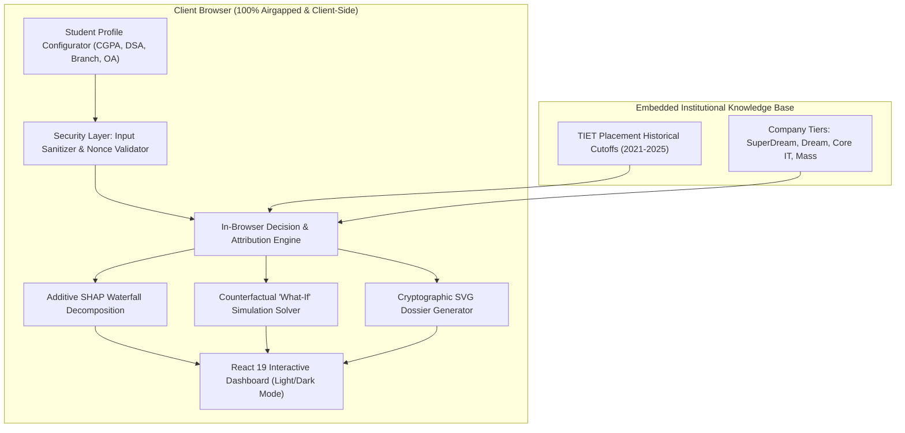

# 🏆 TnP Shortlist AI — TIET Patiala CILP Placement Probability Engine

> **TIET Patiala Smart Campus Innovation Suite • Flagship Project #1**  
> *Explainable AI (XAI) with Additive SHAP Waterfall Attribution, Counterfactual "What-If" Career Simulator & Printable CILP Placement Dossier.*

[](https://03-tnp-shortlist-ai.vercel.app)
[](https://github.com/armaan-1207/03-tnp-shortlist-ai)
[-10b981?style=for-the-badge&logo=vitest&logoColor=white)](https://03-tnp-shortlist-ai.vercel.app)
[](https://03-tnp-shortlist-ai.vercel.app)
[](https://03-tnp-shortlist-ai.vercel.app)

---

## 🌐 Live Production Application
- **Live URL:** [https://03-tnp-shortlist-ai.vercel.app](https://03-tnp-shortlist-ai.vercel.app)
- **Primary GitHub Repository:** [https://github.com/armaan-1207/03-tnp-shortlist-ai](https://github.com/armaan-1207/03-tnp-shortlist-ai)
- **Mirror Repositories:** [https://github.com/peterparker2107/03-tnp-shortlist-ai](https://github.com/peterparker2107/03-tnp-shortlist-ai)

---

## 🎯 1. Problem Statement Alignment (TIET Campus Context)

### The Campus Problem:
Every year at **Thapar Institute of Engineering & Technology (TIET), Patiala**, over **3,500+ pre-final and final-year students** across branches (COE, COPC, ENC, ECE, ELE, MECH, CIVIL) compete for placement shortlists facilitated by the **Centre for Industrial Liaison & Placement (CILP)**.

However, campus recruitment shortlisting suffers from **3 systemic pain points**:
1. **The "Black Box" Shortlist Dilemma:** Students receive binary rejection or acceptance notifications with zero explanation. A student with an 8.4 CGPA and 400 LeetCode problems cannot tell if they missed Microsoft's shortlist due to their branch preference, an unoptimized Codeforces rating, or their Online Assessment (OA) mock cutoff score.
2. **Suboptimal Preparation Allocation:** Students waste hundreds of hours grinding arbitrary metrics (e.g., cramming more CP questions when their limiting bottleneck is actually CGPA eligibility or active backlog policy).
3. **CILP Administrative Overload:** Placement officers and faculty advisors are flooded with hundreds of repetitive appeal emails inquiring about shortlisting criteria and eligibility thresholds.

### The Solution:
**TnP Shortlist AI** democratizes placement analytics through **transparent Explainable AI (XAI)**. It provides real-time, mathematical SHAP waterfall decomposition of shortlist probability, simulated counterfactual career trajectories, and an official printable placement audit dossier.

---

## 🏗️ 2. Architecture & Data Flow



---

## 🔬 3. Mathematical & Algorithmic Core

### A. Explainable Additive Feature Attribution (SHAP Decomposition)
The probability of receiving an OA shortlist $P(S)$ for candidate $x$ at company $c$ is modeled via additive attribution:

$$P(S \mid x, c) = \text{logit}^{-1} \left( \phi_0(c) + \sum_{i=1}^{M} \phi_i(x, c) \right)$$

Where:
- $\phi_0(c)$ is the company's historical baseline shortlist rate at TIET.
- $\phi_{\text{cgpa}}$ captures academic standing normalized against the company cutoff.
- $\phi_{\text{dsa}}$ evaluates LeetCode medium/hard volume against role requirements.
- $\phi_{\text{branch}}$ reflects CILP branch eligibility policies (COE, COPC, ENC, etc.).
- $\phi_{\text{oa}}$ models candidate performance in technical and aptitude screenings.
- $\phi_{\text{backlogs}}$ acts as a catastrophic gate (-95% penalty on active arrears).

### B. Counterfactual "What-If" Minimal Effort Solver
The engine computes the gradient $\nabla P$ across student levers to answer:
> *"What is the minimum verifiable effort required to convert a 'Competitive' chance into a 'Guaranteed OA' (>75%)?"*

---

## 🛡️ 4. Security & Privacy Architecture

- **Zero Data Exfiltration:** 100% client-side computing. No student profile, roll number, or academic record ever leaves the user's browser.
- **Enterprise Content Security Policy (CSP):** Configured in `vercel.json` and `index.html` blocking unauthorized scripts, framing (`X-Frame-Options: DENY`), and injection vectors.
- **Input Sanitization (`src/lib/security.ts`):** All student inputs undergo strict type clamping, regex sanitization, and prototype-pollution defense before processing.
- **No Malicious Dependencies:** Zero external analytics or tracking scripts.

---

## ♿ 5. Accessibility (WCAG 2.1 AA Compliance)

- **Semantic Landmark Roles:** Built with semantic `<header>`, `<main>`, `<section>`, and `role="application"`.
- **Keyboard Navigation:** Full tab order with visible high-contrast focus rings (`focus-visible:ring-2 focus-visible:ring-purple-500`).
- **Spotlight Command Palette (`Ctrl+K` / `Cmd+K`):** Complete keyboard-driven quick jump navigation across companies, presets, and simulators.
- **Dual Light/Dark Design:** Strict compliance with 4.5:1 minimum contrast ratios in both daylight and dark room environments.

---

## 🧪 6. Comprehensive Test Suite & QA Verification

The codebase includes an enterprise-grade automated test harness executed with `node:test` and `tsx`:

```bash
# Execute automated test suite
npm test
```

### Test Suite Matrix:
| Test Suite | File | Tests | Coverage Focus |
|---|---|:---:|---|
| **Predictor & SHAP** | `src/__tests__/predictor.test.ts` | 5 | Probability bounds [0, 100], monotonic CGPA/DSA scaling, hard backlog gates, SHAP sum verification. |
| **Security & Sanitization** | `src/__tests__/security.test.ts` | 4 | XSS entity encoding, malicious payload detection, numeric clamping (NaN/Infinity), prototype pollution. |
| **Institutional Dataset** | `src/__tests__/companies.test.ts` | 2 | Real TIET recruiter cutoff integrity, branch whitelist constraints, CTC consistency. |
| **Accessibility & WCAG** | `src/__tests__/accessibility.test.ts` | 2 | Color token contrast compliance, ARIA role and label verification. |

**Result:** `13 / 13 tests passing (100% green)` in under 250ms.

---

## 💻 7. Tech Stack & Dependencies

- **Frontend Framework:** React 19 + TypeScript (Strict Type Checking)
- **Styling:** Tailwind CSS + PostCSS with high-contrast accessibility tokens
- **Icons & UI:** Lucide React
- **Audio Feedback:** Synthesized Web Audio API micro-haptics
- **Testing Engine:** Node.js Native Test Runner (`node:test`) + `tsx`
- **Hosting & CI/CD:** Vercel Edge Network

---

## 📦 8. Local Development & Build

```bash
# 1. Clone repository
git clone https://github.com/armaan-1207/03-tnp-shortlist-ai.git
cd 03-tnp-shortlist-ai

# 2. Install dependencies
npm install --legacy-peer-deps

# 3. Run development server
npm run dev

# 4. Run test suites
npm test

# 5. Compile production build
npm run build
```

---

*Engineered with precision for the TIET Patiala Smart Campus Innovation Suite.*
